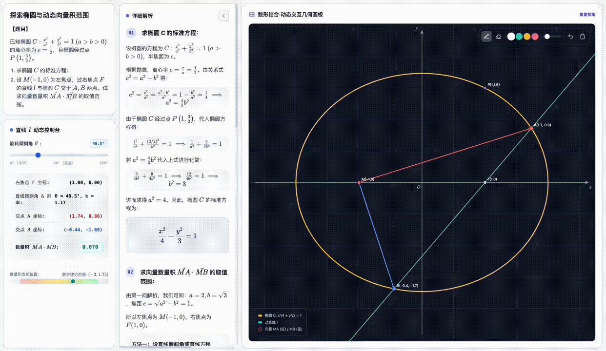

# edulab

[简体中文](README.zh-CN.md) · **English**

A collection of education skills that turn academic problems into **interactive lesson web pages** and **narrated explainer videos**.

## Install

**Recommended** — install with [skills](https://github.com/vercel-labs/skills) in one command:

```bash
npx skills add wy51ai/edulab
```

To update to the latest version later:

```bash
npx skills update
```

> **Note:** `npx skills update` only refreshes skills you've **already** installed — it does **not** pull in skills newly added to the repo. When this repo gains a new skill (e.g. a new `edu-*`), run `npx skills add wy51ai/edulab` again to install it.

Or use it as a Claude Code plugin marketplace:

```
/plugin marketplace add wy51ai/edulab
/plugin install edulab
```

Once installed, the skills activate on their trigger words, and can also be invoked manually.

## Skill: edu-solid-geometry


Solves one solid geometry problem into a self-contained interactive lesson page. Three entry points:

| Entry point | What it does |
|---|---|
| Text problem | Extracts the statement and solves directly |
| Image upload | Reads the problem from the image via vision, echoes it back for confirmation, then solves |
| Random problem | Solves with random parameters; re-rolls if the answer isn't clean |

**Problem types covered**: line-plane angle, dihedral angle, angle between skew lines, point-to-plane distance, volume, and more — on cubes / cuboids, pyramids / prisms, cylinders / cones. All solved uniformly via the "coordinate system + vector method."

**Trigger words**: solid geometry, line-plane angle, dihedral angle, angle between skew lines, distance to plane, interactive geometry solution page; 立体几何、线面角、二面角、异面直线、点到平面距离、正四棱锥、解这道几何题、随机出一道立体几何题、这张图里的立体几何题, etc.

### Dependency

The compute core `lib/geometry_kernel.py` depends on **sympy**. Use any `python3` that can import sympy:

```bash
python3 -m pip install sympy   # if sympy is missing
```

### Generate from the command line (without Claude)

```bash
cd skills/edu-solid-geometry
python3 scripts/generate.py cube   ./cube.html     # cube · line-plane angle
python3 scripts/generate.py box    ./box.html      # cuboid · volume
python3 scripts/generate.py random 7 ./random.html # random problem (seed=7)
python3 lib/geometry_kernel.py                     # kernel built-in self-check
```

> If you don't pass an output path, it writes to the **current working directory (cwd)**.

## Skill: edu-analytic-geometry



Solves one analytic geometry (conic sections) problem into a self-contained interactive lesson page. Same three entry points as above (text / image / random). Built on a **2D Canvas board + KaTeX** with a generic, data-driven interactive engine: a parameter slider drives derived constructions (line∩conic, point-on-conic, central reflection, tangent…) and live readouts, with a theoretical-range bar or a fixed-value indicator.

**Problem types covered**: standard equation, chord length, dot-product range / fixed value, triangle-area extremum, fixed point, fixed value (slope product), locus, tangent, eccentricity — on ellipses / hyperbolas / parabolas / circles. All solved uniformly via "parametrized line `x = my + c` + system + Vieta's formulas + substitution."

> A correctness note baked into the kernel: open/closed interval endpoints are decided by whether a *real* line attains them, so the boxed answer always matches what the interactive tool shows (e.g. the ellipse `MA·MB` range is the **closed** `[-3, 7/4]` — slide θ to 0° and you read exactly −3).

**Trigger words**: analytic geometry, conic sections, ellipse, hyperbola, parabola, chord length, dot product range, fixed point, fixed value, locus, eccentricity, interactive analytic geometry solution page; 解析几何、圆锥曲线、椭圆、双曲线、抛物线、焦点弦、向量数量积取值范围、定点问题、定值问题、斜率之积、三角形面积最值、轨迹方程、离心率, etc.

### Dependency

The compute core `lib/analytic_kernel.py` depends on **sympy** (same as above).

### Generate from the command line (without Claude)

```bash
cd skills/edu-analytic-geometry
python3 scripts/generate.py list                          # list registered problem types
python3 scripts/generate.py ellipse_dot_range ./sol.html  # ellipse · MA·MB range [-3, 7/4]
python3 scripts/generate.py parabola_dot_const ./sol.html # parabola focal chord · OA·OB ≡ -3
python3 scripts/generate.py all ./out_dir                 # all registered types
python3 lib/analytic_kernel.py                            # kernel built-in self-check
```

> Like above, no output path → writes to the **current working directory (cwd)**.

## Skill: edu-chem-reaction


Turns one chemical reaction into a self-contained **microscopic 3D demonstration** page: an interactive Three.js molecular animation (drag the slider to watch bonds break / form and atoms recombine, with step highlighting) next to the KaTeX equation, step-by-step narration, an atom-conservation counter, and an optional energy–reaction-coordinate curve. Same three entry points (text / image / random).

**Two engines, auto-selected** — one renderer with two per-frame position resolvers, sharing the bond-diff drawing, labels, overlays and UI:

| Engine | For | Emphasizes |
|---|---|---|
| morph | combustion, combination / decomposition / displacement, redox | atoms fly to new partners — atom conservation & recombination |
| mechanism | organic mechanisms (esterification…) with catalyst · transition state · leaving groups | rigid fragments move through keyframes — the mechanism |

**sympy-driven correctness**: auto-balances the equation (integer coefficients from the matrix null space), validates the atom map (a bijection between reactant and product atoms) and conservation, and derives which bonds break / form from the before↔after difference — equation, geometry and counters all share one source.

**Hybrid geometry**: a built-in VSEPR molecule library by default; if RDKit is installed it can build conformers from SMILES (never installs it automatically).

**Reactions covered**: methane / hydrogen combustion, water electrolysis, Na + Cl₂ redox (with an electron-transfer overlay), glucose aerobic oxidation, and the esterification mechanism — spanning junior-high basics, senior inorganic redox, and organic mechanisms.

**Trigger words**: chemistry reaction, microscopic / molecular animation, combustion, electrolysis, redox electron transfer, esterification mechanism, bond breaking and forming, atom conservation, balance equation, interactive chemistry reaction page; 化学反应、微观演示、分子动画、燃烧、电解水、氧化还原、电子转移、酯化反应、断键成键、原子守恒、化学方程式配平 etc.

### Dependency

The compute core `lib/reaction_kernel.py` depends on **sympy** (same as above). **RDKit is optional** — used only if already installed, never installed automatically.

### Generate from the command line (without Claude)

```bash
cd skills/edu-chem-reaction
python3 scripts/generate.py list                            # list registered reactions
python3 scripts/generate.py combustion_ch4 ./reaction.html  # methane combustion (morph · flame)
python3 scripts/generate.py esterification ./reaction.html  # esterification (mechanism · catalyst)
python3 scripts/generate.py random 7 ./random.html          # random reaction (seed=7)
python3 lib/reaction_kernel.py                              # kernel built-in self-check
```

> Like above, no output path → writes to the **current working directory (cwd)**.

## Skill: edu-math-video


Turns one math problem (geometry, algebra, functions, motion problems…) into a **16:9 1920×1080 explainer video** with Chinese voice-over. Input is a problem screenshot or plain text. **You get a browser preview first** (plays directly, seekable); exporting the MP4 is optional and asked at the end.

- **Five visual templates**: `handdrawn` (hand-drawn notebook-style canvas animation driven by the narration timeline, bilingual zh + en subtitles, background music) and four board styles — `chalk`, `lab`, `whiteboard`, `notebook` — written as a declarative `lesson.json` (auto board layout, auto-rotating 3D figures with live hidden-line computation; opens by writing the problem on the board and reading it segment by segment, the segment being read changing color; formulas typeset in LaTeX via KaTeX; no need to pick a style up front — switch styles live in the preview page; the style is only asked when you export an MP4).
- **Five TTS engines**: Zhipu **GLM-TTS**, **Doubao** seed-tts 2.0, **MiniMax** (Doubao and MiniMax return word timestamps, so board actions sync to the exact word), plus free fallbacks edge-tts / macOS `say`. Both pipelines share `shared/tts.py`.

**The picture explains the step**: every narration line gets a "point → move → keep" action on the figure (equal segments slide onto each other, congruent triangles overlay, the 3D camera tweens to a top view, a cone unrolls into a sector…) — timed by `S.at(k, f)` (a fraction into line *k*), never by hard-coded seconds. A `motion` check rejects static lines.

**Pipeline** (one folder per video, created in the user's current directory):

```
handdrawn: script.json ──build_audio.py──► timeline.json + mix.wav + <name>.srt   (TTS + synthesized music)
           anim.js + engine.js ──► index.html (plays in a browser) ──node render.mjs video──► <name>.mp4 (optional)
board:     lesson.json ──make.mjs──► preview.html (plays in a browser) + subtitles.srt ──render.mjs──► video.mp4 (optional)
```

**Flow**: step 0 checks that the TTS key works (if not, it creates `.env` for you to fill in and waits) → solve and verify → free preview of layout and pronunciation → real voice-over → open the web preview (this is the delivery) → ask whether to export an MP4 (no → done; yes → board templates then ask which style to export).

**Guard rails**: the first scene shows the original problem (handdrawn boxes each condition; board styles read it segment by segment); board formulas must be LaTeX (plain-text `4√3`, `x²` are rejected); `tts` text must be speakable Chinese (no digits / math symbols); polyphones are pinned (`长[cháng]`, shared `pron.json` lexicon) and `--check` must report 0 before any paid TTS call; a free `--preview` + contact-sheet review comes before real audio; `--asr` transcribes the audio back to catch misread letters.

**Trigger words**: math explainer video, walkthrough video, problem-solving video, micro-lesson; 讲解视频、解题视频、例题精讲、微课 etc.

### Dependency

- Python 3 with `numpy requests pypinyin pillow`; Node.js 18+ with `playwright` + `ffmpeg-static` (installed once in the workspace — `scripts/new_video.sh` writes the `package.json`); Google Chrome or Playwright Chromium.
- Board templates: `npm install` once in `skills/edu-math-video/lesson/` (playwright, katex, fonts).
- A TTS key provided by you (any one): `GLM_API_KEY`, `DOUBAO_API_KEY` (+ `DOUBAO_VOICE`), or `MINIMAX_API_KEY`, in the `.env` of the directory you work in (`scripts/init_env.sh` creates it with empty slots; see `reference/tts-setup.md`). `python3 skills/edu-math-video/shared/tts.py info` shows which engine will be used.
- **No key?** It never silently switches to a free voice: Claude asks whether you want to add a key or use the free [edge-tts](https://github.com/rany2/edge-tts) (needs internet) / macOS `say` (offline, robotic, lower quality). When running by hand, choose one explicitly with `TTS_ENGINE=edge|say`; `TTS_ENGINE=glm|doubao|minimax` and `VIDEO_TEMPLATE=<template>` set your defaults.

### Run the pipeline by hand (without Claude)

```bash
bash skills/edu-math-video/scripts/new_video.sh "$PWD" my_problem   # scaffold from template/
bash skills/edu-math-video/scripts/setup_check.sh my_problem        # must print ALL OK
cd my_problem
python3 build_audio.py --check                                      # script + pronunciation lint (free)
python3 build_audio.py --preview && node render.mjs motion && node render.mjs stills auto
python3 build_audio.py && node render.mjs stills auto                # real TTS (stills also writes build/timeline.js for the preview)
open index.html                                                     # plays in the browser: click/space, drag the bar, ←/→ = 5 s
node render.mjs video 6                                             # optional: export the MP4 (6 = parallel pages); or ./make.sh video

# Board templates: write my_lesson/lesson.json (with the problem-reading "intro"; examples in lesson/examples/)
node skills/edu-math-video/lesson/scripts/make.mjs my_lesson/lesson.json --preview             # free layout check (no TTS)
node skills/edu-math-video/lesson/scripts/make.mjs my_lesson/lesson.json --style lab --tts doubao  # real TTS + preview.html (no MP4)
open my_lesson/preview.html                                                                    # plays in the browser; switch styles bottom-right
node skills/edu-math-video/lesson/scripts/render.mjs my_lesson                                 # optional: export the MP4 (or make.mjs --render)
```

## Skill: edu-physics-video


Turns one physics problem (mechanics, optics, electromagnetism…) into a **16:9 1920×1080 explainer video** (browser preview `index.html` first, MP4 export optional): Chinese voice-over (Zhipu **GLM-TTS**), bilingual zh + en subtitles (`.srt` too), and blueprint-style canvas animation driven by the narration timeline. Input is a problem screenshot or plain text. Same pipeline as edu-math-video; what changes is the solving method and the picture.

**The picture follows the physics**: model the object, split the motion into segments, draw the forces, pick a law, solve, then check. Force arrows grow from the point of application on one scale, the object moves on the analytic solution `x(t)` through a linear `simT()` map, the v–t graph grows in sync, and friction reverses when the relative motion does. Timed by `S.at(k, f)`.

**Pipeline** (one folder per video, created in the user's current directory):

```
script.json ──build_audio.py──► timeline.json + mix.wav + <name>.srt   (GLM-TTS + synthesized music)
anim.js + phys.js + engine.js ──► index.html (plays in a browser) ──node render.mjs video──► <name>.mp4 (optional)
```

**Guard rails**: the first scene shows the original problem with each condition boxed as it is read; `tts` text must be speakable Chinese (units read aloud; no digits or math symbols; θ is 西塔); polyphones are pinned and `--check` must report 0 before any paid TTS call; a free `--preview` plus a contact-sheet review comes before real audio; `--asr` transcribes the audio back to catch misread letters. Shared physics props go in `phys.js`. Leave `engine.js` unchanged.

**Trigger words**: physics explainer video, force diagram, Newton's laws, incline, projectile, circular motion, energy, momentum, refraction; 物理题视频、受力分析、牛顿定律、斜面、平抛、圆周、能量、动量、折射 etc.

### Dependency

Same as edu-math-video: Python 3 with `numpy requests pypinyin pillow`, Node.js 18+ with `playwright` + `ffmpeg-static`, and a Zhipu **`GLM_API_KEY`** in the `.env` of the directory you work in (`scripts/init_env.sh` creates it with an empty slot). The key is checked first; with no key there is no silent fallback — set `TTS_ENGINE=edge|say` to use the free [edge-tts](https://github.com/rany2/edge-tts) or macOS `say` (lower quality).

### Run the pipeline by hand (without Claude)

```bash
bash skills/edu-physics-video/scripts/new_video.sh "$PWD" my_problem
bash skills/edu-physics-video/scripts/setup_check.sh my_problem        # must print ALL OK
cd my_problem
python3 build_audio.py --check
python3 build_audio.py --preview && node render.mjs motion && node render.mjs stills auto
python3 build_audio.py && node render.mjs video 6
```

## Skill: edu-chem-video


Turns one chemistry problem (redox balancing and the double-line bridge, amount of substance, equilibrium and the ICE table, ionic reactions, electrochemistry, titration, industrial processes…) into a **16:9 1920×1080 explainer video** (browser preview first, MP4 export optional) with the same voice-over and bilingual subtitles, drawn on a **green chalkboard**. The balanced equation stays pinned in a strip at the top; the demo sits on the left and the slate on the right.

**The equation does the explaining, and conservation is counted on screen**: oxidation numbers rise and fall on a number line, electrons group until the counts match, coefficients fly from the electron row into the equation, atom tallies check off, the double-line bridge shows electron flow, molecule boxes react in the coefficient ratio, and the ICE table fills row by row. `scripts/chem_check.py` checks the balance and atom / charge conservation before any drawing. In `tts`, formulas become names (`HNO3` → 硝酸, `SO4^{2-}` → 硫酸根离子); the `zh` subtitle keeps the formula and renders subscripts.

**Pipeline**: same shape as above, with `chem.js` next to `engine.js` (`equation`, `valence`, `bridge`, `eFlow`, `tally`, `molMap`, `iceTable`, `molecule`, `beaker`, `graph`).

**Guard rails**: the same TTS, preview, and `--asr` rules as the other video skills, and `chem_check.py check` must exit 0. Oxidation states, coefficients, bridge endpoints, and molecule counts match the solution card. Lost electrons / oxidation are blue; gained electrons / reduction are red. Shared chemistry props go in `chem.js`. Leave `engine.js` unchanged.

**Trigger words**: chemistry explainer video, redox, electron conservation, double-line bridge, amount of substance, chemical equilibrium, ICE table, titration; 化学题视频、氧化还原配平、双线桥、电子守恒、物质的量、化学平衡、三段式、滴定 etc.

### Dependency

Same as edu-physics-video (`GLM_API_KEY`, checked first; free engines only when set explicitly with `TTS_ENGINE=edge|say`). `scripts/chem_check.py` needs no extra packages — it checks coefficients, atom / charge conservation, and molar mass.

### Run the pipeline by hand (without Claude)

```bash
bash skills/edu-chem-video/scripts/new_video.sh "$PWD" my_problem
bash skills/edu-chem-video/scripts/setup_check.sh my_problem           # must print ALL OK
cd my_problem
python3 build_audio.py --check
python3 build_audio.py --preview && node render.mjs motion && node render.mjs stills auto
python3 build_audio.py && node render.mjs video 6
```

## Skill: edu-math-book

Turns **any high-school math problem** into an interactive "workbook open on a desk" page: the left page carries the problem, key ideas, the questions and a predict-then-lift-the-flap quiz; the right page has a pencil-sketch figure. In demo mode the figure stands up off the page while a fountain pen writes each reasoning chain on scratch paper; coloured symbols highlight the matching parts of the figure, and sliders let students experiment. Optional **classroom intro** (a classmate asks the question on video, music, a WebGL classroom, then the camera drops to the desk).

Three renderers cover all of high-school math: `solid` (polyhedra with automatic edges/visibility + cylinders/cones/spheres), `plane` (function & derivative graphs, conics, plane geometry, bar charts — it pops up like a pop-up card), and `none` (sequences, inequalities, counting/probability — the right page becomes a formula board). Each problem is one `lesson.js`; the whole shell lives in the template.

```bash
python3 skills/edu-math-book/scripts/generate.py lesson.js out/index.html     # add --intro for the classroom intro
node skills/edu-math-book/scripts/check.mjs out/index.html                   # screenshots of every step + errors/lint
```

Examples live in `skills/edu-math-book/examples/` (right prism, tetrahedron + intro, cubic zeros, sequence).

## How it works

1. **Get a problem spec** — normalize all three entry points into a structured description (body type and dimensions, given conditions, the quantity asked, language).
2. **Exact kernel computation** — sympy computes exact coordinates, key vectors, normals, the final answer, and every intermediate value (as LaTeX strings). Never by hand.
3. **Assemble and inject the template** — feed the `lesson` / `steps` / `model` data into the data-driven template `template/lesson.html`; 3D vertex coordinates come from `kernel.to_three(...)`, sharing the same source as the solution.
4. **Self-check** — kernel answer == answer card == final value shown in the last step; a local static server + preview check confirms no console errors and correct formula/highlight rendering.
5. **Deliver** — the finished page is written to the user's current working directory, named like `solution-<short-description>.html`.

## Project structure

```
edulab/
├── .claude-plugin/
│   ├── plugin.json              # plugin metadata
│   └── marketplace.json         # marketplace manifest
├── index.html                   # finished sample (quad pyramid · line-plane angle)
└── skills/
    ├── edu-solid-geometry/      # solid geometry — 3D (Three.js) + MathJax
    │   ├── SKILL.md
    │   ├── template/lesson.html # data-driven template (generic 3D renderer + data island)
    │   ├── lib/
    │   │   ├── geometry_kernel.py  # sympy exact-computation core
    │   │   └── bodies.py           # edge-topology library for solids
    │   ├── scripts/generate.py
    │   ├── output/
    │   └── references/          # problem-schema.md · conventions.md
    ├── edu-analytic-geometry/   # analytic geometry / conics — 2D (Canvas) + KaTeX
    │   ├── SKILL.md
    │   ├── template/board.html  # data-driven template (generic 2D renderer + param engine)
    │   ├── lib/
    │   │   ├── analytic_kernel.py  # sympy exact-solver core (system · Vieta · range · fixed value)
    │   │   └── conics.py           # conic-section definition library
    │   ├── scripts/generate.py
    │   ├── output/
    │   └── references/          # problem-schema.md · conventions.md
    ├── edu-chem-reaction/       # chemistry reactions — 3D (Three.js) + KaTeX
    │   ├── SKILL.md
    │   ├── template/reaction.html # data-driven template (unified renderer + dual engine + data island)
    │   ├── lib/
    │   │   ├── reaction_kernel.py  # sympy balancing + conservation/atom-map check + bond-diff + assembly
    │   │   └── molecules.py        # VSEPR molecule-geometry library
    │   ├── scripts/generate.py
    │   ├── output/
    │   └── references/          # problem-schema.md · conventions.md
    ├── edu-math-video/          # math explainer videos — 5 templates × 5 TTS engines → web preview (MP4 optional)
    │   ├── SKILL.md
    │   ├── lesson/              # board-template engine (chalk/lab/whiteboard/notebook): make.mjs · lesson.json docs & examples
    │   ├── template/            # handdrawn sample project (engine.js · anim.js · build_audio.py · render.mjs)
    │   ├── shared/              # tts.py (five TTS engines) + pron.py / pron.json (shared pronunciation lexicon)
    │   ├── scripts/             # new_video.sh · setup_check.sh · init_env.sh · problem image & contact-sheet tools
    │   ├── examples/cone-parallel/  # solid-geometry example (camera tween · cone unrolling)
    │   └── reference/           # TTS setup · script writing · pronunciation · visual design · animation API
    ├── edu-physics-video/       # physics explainer videos — GLM-TTS + blueprint canvas → web preview (MP4 optional)
    │   ├── SKILL.md
    │   ├── template/            # blueprint theme (engine.js · phys.js · anim.js)
    │   ├── shared/
    │   ├── scripts/
    │   ├── examples/laser-curvature/  # geometric-optics example
    │   └── reference/
    ├── edu-chem-video/          # chemistry explainer videos — GLM-TTS + chalkboard canvas → web preview (MP4 optional)
    │   ├── SKILL.md
    │   ├── template/            # chalkboard theme (engine.js · chem.js · anim.js)
    │   ├── shared/
    │   ├── scripts/             # plus chem_check.py — balance and conservation check
    │   ├── examples/equilibrium/    # ICE-table / equilibrium example
    │   └── reference/
    └── edu-math-book/           # desk-and-book interactive workbook — all high-school math (solid / plane / none) + optional classroom intro
        ├── SKILL.md
        ├── template/            # shell: book.html · core.js · renderers.js · props.js · scene.js · intro_gl.js
        ├── assets/intro/        # intro media (video, music, wood textures), copied only with --intro
        ├── scripts/             # generate.py · check.mjs
        ├── examples/            # solid_prism · solid_pyramid · plane_function · none_sequence
        └── references/          # lesson-schema.md · renderers.md · pedagogy.md
```

## Extending

**edu-solid-geometry**
- **Add a problem type**: add a solver function in `geometry_kernel.py` (see the recipe table in `references/conventions.md`), then add a `build_*` in `generate.py`.
- **Add a solid**: add a coordinate-construction function in `geometry_kernel.py`, then add its edge topology in `bodies.py`.

**edu-analytic-geometry**
- **Add a problem type**: add a target-quantity function in `analytic_kernel.py` and reuse `range_over_m` / `is_constant_in_m`, then add a `build_*` in `generate.py` (pick an interaction: range bar / fixed value / fixed point / locus trace).
- **Add a curve**: ellipse / hyperbola / parabola / circle are built in; new curves go in `conics.py` and the `board.html` engine.

**edu-chem-reaction**
- **Add a reaction**: add a `build_*` in `generate.py` (high-level `species + atom_map`, or low-level `atoms + fragments` for mechanisms) and register it in `REGISTRY`.
- **Add a molecule / ion**: add an entry in `lib/molecules.py` (VSEPR geometry + display metadata + internal bonds).

**edu-math-video**
- **New problem (board)**: write only `lesson.json` (`intro` + scenes; see `lesson/reference/lesson-schema.md`); don't touch the engine.
- **New problem (handdrawn)**: never edit `engine.js`; write the per-problem `script.json` / `storyboard.md` / `anim.js`, and add new figure helpers inside `anim.js`.
- **Fix a reading**: add the word to `shared/pron.json` (`words` / `ok`) — one lexicon shared by every video.

**edu-physics-video**
- **New problem**: leave `engine.js` unchanged; write the per-problem `script.json` / `storyboard.md` / `anim.js`. Shared physics props go in `phys.js`.
- **Fix a reading**: add the word to `shared/pron.json`.

**edu-chem-video**
- **New problem**: leave `engine.js` unchanged; write the per-problem files. Shared chemistry props go in `chem.js`. Run `scripts/chem_check.py` on the equation before drawing.
- **Fix a reading**: add the word to `shared/pron.json`.

## License

[Apache-2.0](LICENSE)

## Author

WY · [@akokoi1](https://x.com/akokoi1)

| WeChat | Xiaohongshu |
|---|---|
| <a href="http://weixin.qq.com/r/mp/kUwUDP3EZKAbrblv9xmD"></a> | <a href="http://xhslink.com/m/64K17dDQNvj"></a> |

## Star History

<a href="https://www.star-history.com/?repos=wy51ai%2Fedulab&type=date&legend=top-left">
 <picture>
   <source media="(prefers-color-scheme: dark)" srcset="https://api.star-history.com/chart?repos=wy51ai/edulab&type=date&theme=dark&legend=top-left" />
   <source media="(prefers-color-scheme: light)" srcset="https://api.star-history.com/chart?repos=wy51ai/edulab&type=date&legend=top-left" />
   
 </picture>
</a>
