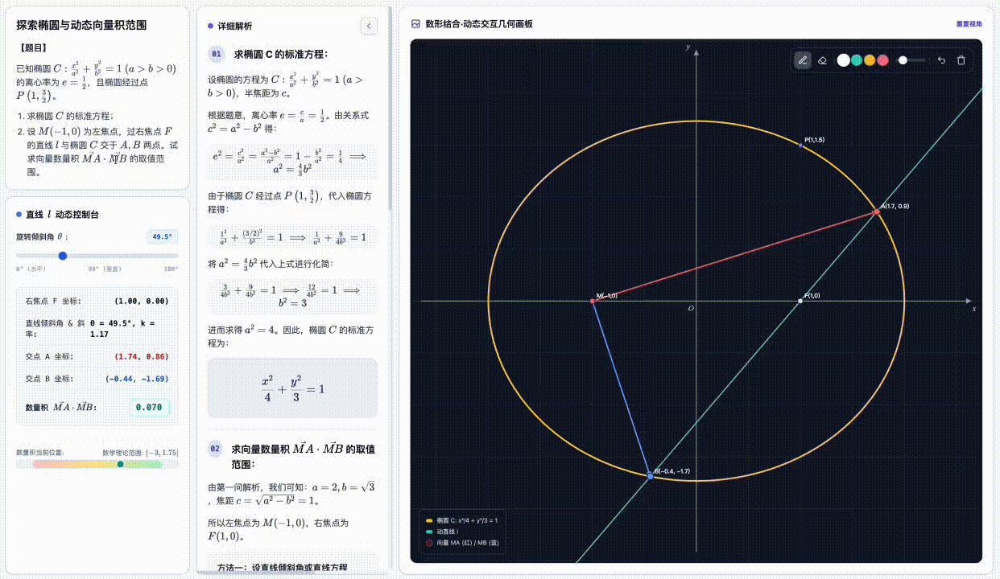

# edulab

**简体中文** · [English](README.md)

教育类技能集合：把学科问题转成**可交互的教学网页**和**带配音的讲解视频**。

## 安装

**推荐** —— 用 [skills](https://github.com/vercel-labs/skills) 一行命令安装：

```bash
npx skills add wy51ai/edulab
```

后续更新到最新版：

```bash
npx skills update
```

> **注意**：`npx skills update` 只会把**已安装**的技能刷新到最新版，**不会**自动拉取仓库新增的技能。当本仓库新增了技能（如新的 `edu-*`）时，再次运行 `npx skills add wy51ai/edulab` 即可装上。

或作为 Claude Code 插件市场使用：

```
/plugin marketplace add wy51ai/edulab
/plugin install edulab
```

安装后，技能会随触发词自动激活，也可以手动调用。

## 技能：edu-solid-geometry


把一道立体几何题解成一个自包含的交互教学网页。支持三种入口：

| 入口 | 说明 |
|---|---|
| 文字题目 | 直接抽取题面求解 |
| 上传图片 | 视觉读图识别题目，回显确认后求解 |
| 随机出题 | 随机参数求解，答案不规整自动重抽 |

**覆盖题型**：正方体 / 长方体、棱锥 / 棱柱、圆柱 / 圆锥上的——线面角、二面角、异面直线夹角、点到平面距离、体积等。统一用"建系 + 向量法"。

**触发词**：立体几何、线面角、二面角、异面直线、点到平面距离、正四棱锥、解这道几何题、随机出一道立体几何题、这张图里的立体几何题；solid geometry, line-plane angle, dihedral angle, distance to plane, interactive geometry solution page 等。

### 依赖

计算核心 `lib/geometry_kernel.py` 依赖 **sympy**。用任意一个能 import sympy 的 `python3` 即可：

```bash
python3 -m pip install sympy   # 若缺 sympy
```

### 命令行直接生成（不经过 Claude）

```bash
cd skills/edu-solid-geometry
python3 scripts/generate.py cube   ./cube.html     # 正方体·线面角
python3 scripts/generate.py box    ./box.html      # 长方体·体积
python3 scripts/generate.py random 7 ./random.html # 随机出题（seed=7）
python3 lib/geometry_kernel.py                     # kernel 内置样例自检
```

> 不传输出路径时，默认写到**当前工作目录（cwd）**。

## 技能：edu-analytic-geometry



把一道解析几何（圆锥曲线）题解成一个自包含的交互教学网页。三入口与上面一致（文字 / 图片 / 随机）。基于 **2D Canvas 画板 + KaTeX** 的通用数据驱动交互引擎：一个参数滑块驱动派生构造（直线∩曲线、曲线上动点、中心对称、切线…）与实时读数，并配理论范围条或定值指示。

**覆盖题型**：求标准方程、弦长、向量数量积取值范围 / 定值、三角形面积最值、定点、定值（斜率之积）、轨迹、切线、离心率——涵盖椭圆 / 双曲线 / 抛物线 / 圆。统一用"设含参直线 `x=my+c` + 联立 + 韦达 + 换元"。

> kernel 内置的一个正确性细节：区间端点的开 / 闭由"是否有真实直线取到"判定，所以框出的答案始终与交互工具一致（例如椭圆 `MA·MB` 的范围是**闭区间** `[-3, 7/4]`——把 θ 拖到 0° 屏幕上正好读到 −3）。

**触发词**：解析几何、圆锥曲线、椭圆、双曲线、抛物线、焦点弦、向量数量积取值范围、定点问题、定值问题、斜率之积、三角形面积最值、轨迹方程、离心率；analytic geometry, conic sections, ellipse, hyperbola, parabola, chord length, dot product range, fixed point, locus, interactive analytic geometry solution page 等。

### 依赖

计算核心 `lib/analytic_kernel.py` 依赖 **sympy**（同上）。

### 命令行直接生成（不经过 Claude）

```bash
cd skills/edu-analytic-geometry
python3 scripts/generate.py list                          # 列出已注册题型
python3 scripts/generate.py ellipse_dot_range ./sol.html  # 椭圆 · MA·MB 范围 [-3, 7/4]
python3 scripts/generate.py parabola_dot_const ./sol.html # 抛物线焦点弦 · OA·OB ≡ -3
python3 scripts/generate.py all ./out_dir                 # 全部已注册题型
python3 lib/analytic_kernel.py                            # kernel 内置自检
```

> 同上，不传输出路径时默认写到**当前工作目录（cwd）**。

## 技能：edu-chem-reaction


把一个化学反应做成自包含的**微观 3D 演示**网页：一侧是可交互的 Three.js 分子动画（拖滑块看化学键断裂 / 生成、原子重新组合，分步高亮），另一侧是 KaTeX 反应方程 + 分步讲解 + 原子守恒计数 + 可选能量-反应进程曲线。三入口与上面一致（文字 / 图片 / 随机）。

**双引擎自动选择** —— 一套渲染器、两种逐帧定位，共用键差绘制、标签、叠加层与 UI：

| 引擎 | 适用 | 强调 |
|---|---|---|
| morph | 燃烧、化合 / 分解 / 置换、氧化还原 | 原子各自飞向新搭档——原子守恒与重组 |
| mechanism | 有机机理（酯化…），含催化剂 · 过渡态 · 离去基团 | 分子片段按关键帧刚体位移——反应机理 |

**sympy 驱动的正确性**：自动配平方程（由元素矩阵零空间求整数计量数）、校验原子映射（反应物↔产物原子的双射）与守恒，并由反应前后键的差集推导哪根键断 / 成——方程、几何、计数器同源一致。

**混合几何**：默认用自建 VSEPR 分子库；若环境装有 RDKit 则可由 SMILES 生成构象（绝不自动安装）。

**覆盖反应**：甲烷 / 氢气燃烧、电解水、钠与氯气氧化还原（含电子转移叠加层）、葡萄糖有氧氧化、酯化机理——涵盖初中基础、高中无机氧化还原与有机机理。

**触发词**：化学反应、微观演示、分子动画、燃烧、电解水、氧化还原、电子转移、酯化反应、断键成键、原子守恒、化学方程式配平；chemistry reaction, microscopic/molecular animation, combustion, electrolysis, redox electron transfer, esterification mechanism, atom conservation, interactive chemistry reaction page 等。

### 依赖

计算核心 `lib/reaction_kernel.py` 依赖 **sympy**（同上）。**RDKit 为可选项**——装了才用，绝不自动安装。

### 命令行直接生成（不经过 Claude）

```bash
cd skills/edu-chem-reaction
python3 scripts/generate.py list                            # 列出已注册反应
python3 scripts/generate.py combustion_ch4 ./reaction.html  # 甲烷燃烧（morph · 火焰）
python3 scripts/generate.py esterification ./reaction.html  # 酯化反应（mechanism · 催化剂）
python3 scripts/generate.py random 7 ./random.html          # 随机出题（seed=7）
python3 lib/reaction_kernel.py                              # kernel 内置自检
```

> 同上，不传输出路径时默认写到**当前工作目录（cwd）**。

## 技能：edu-math-video


把一道数学题（几何、代数、函数、行程问题……）做成 **16:9、1920×1080、带中文配音的讲解视频**，输入可以是题目截图或文字。**先生成能直接在浏览器里播放的网页预览**（可拖动进度条），看过之后再决定要不要导出 MP4。

- **五种画面模板**：`handdrawn` 手绘动画（按旁白时间轴驱动的手绘笔记本风格 canvas 动画 + 中英双语字幕 + 背景音乐），以及四种板书模板 `chalk` 粉笔黑板 / `lab` 几何实验室 / `whiteboard` 白板马克笔 / `notebook` 方格本（写声明式 `lesson.json`，引擎自动排版板书、立体图自动旋转并实时计算虚实线；开头先把题目写在板上逐段朗读，正在读的那段变色；公式用 LaTeX（KaTeX）排版；风格不用事先选，预览页右下角随时切换，导出 MP4 时才问用哪种）。
- **五种配音引擎**：智谱 **GLM-TTS**、**豆包**语音合成 2.0、**MiniMax**（豆包和 MiniMax 返回逐字时间戳，板书动作精确对齐到字），以及免费兜底 edge-tts / macOS `say`。两条流水线共用 `shared/tts.py`。

**图会"讲题"**：每句旁白在图上都有一个"指 → 动 → 留"的动作（相等线段滑过去重合、全等三角形叠上去、3D 相机转到俯视、圆锥侧面展开成扇形……），用 `S.at(k, f)`（第 k 句开始后 f 比例处）定时，绝不写死秒数；`motion` 检查会拦下静止不动的句子。

**流水线**（每个视频一个文件夹，建在用户当前目录）：

```
手绘：script.json ──build_audio.py──► timeline.json + mix.wav + <name>.srt   （配音 + 合成音乐）
      anim.js + engine.js ──► index.html（浏览器直接播放）──node render.mjs video──► <name>.mp4（可选）
板书：lesson.json ──make.mjs──► preview.html（浏览器直接播放）+ subtitles.srt ──render.mjs──► video.mp4（可选）
```

**流程**：第 0 步先确认配音 key 可用（没配就建好 `.env` 请你填，填好再继续，不会做到一半才发现不能配音）→ 解题并验算 → 免费预览检查版面和读音 → 真配音 → 打开网页预览并交付 → 问要不要导出 MP4（选不导出就结束；导出时板书再问用哪种风格）。

**护栏**：第一幕展示原题（手绘逐条框出条件，板书逐段朗读并变色）；板书里的公式必须写成 LaTeX（`4√3`、`x²` 这类纯文本会被拦下）；`tts` 字段只能是能念出来的中文（无数字/数学符号）；多音字必须固定读音（`长[cháng]`，共享 `pron.json` 词表），`--check` 为 0 才允许调用付费 TTS；先免费 `--preview` + 截图拼图审查版面，再生成真配音；`--asr` 把配音转回文字核对字母读音。

**触发词**：讲解视频、解题视频、例题精讲、微课、数学题视频；math explainer video、walkthrough video 等。

### 依赖

- Python 3 + `numpy requests pypinyin pillow`；Node.js 18+ + `playwright` + `ffmpeg-static`（在工作目录装一次，`scripts/new_video.sh` 会生成 `package.json`）；Google Chrome 或 Playwright Chromium。
- 板书模板另需在 `skills/edu-math-video/lesson/` 下 `npm install` 一次（playwright、katex、字体）。
- 由你自己提供的配音 key（任选其一）：`GLM_API_KEY`、`DOUBAO_API_KEY`（+ `DOUBAO_VOICE`）、`MINIMAX_API_KEY`，写在当前工作目录的 `.env`（`scripts/init_env.sh` 会建好空位；见 `reference/tts-setup.md`）。`python3 skills/edu-math-video/shared/tts.py info` 查看当前会用哪个引擎。
- **没有 key？** 不会悄悄换成免费配音：Claude 会先问你是填 key，还是用免费的 [edge-tts](https://github.com/rany2/edge-tts)（需联网）/ macOS 自带 `say`（离线，机械感明显，效果较差）。手动运行时用 `TTS_ENGINE=edge|say` 明确指定；也可用 `TTS_ENGINE=glm|doubao|minimax` 固定默认引擎、`VIDEO_TEMPLATE=<模板>` 固定默认模板。

### 手动跑流水线（不经过 Claude）

```bash
bash skills/edu-math-video/scripts/new_video.sh "$PWD" my_problem   # 从 template/ 建项目
bash skills/edu-math-video/scripts/setup_check.sh my_problem        # 必须输出 ALL OK
cd my_problem
python3 build_audio.py --check                                      # 脚本 + 读音检查（免费）
python3 build_audio.py --preview && node render.mjs motion && node render.mjs stills auto
python3 build_audio.py && node render.mjs stills auto                # 真配音（stills 同时生成预览用的 build/timeline.js）
open index.html                                                     # 浏览器直接播放：点画面/空格播放，拖进度条，←/→ 跳 5 秒
node render.mjs video 6                                             # 可选：导出 MP4（6 = 并行页数）；./make.sh video 一步到位

# 板书模板：写好 my_lesson/lesson.json（含开头读题的 intro，范例见 lesson/examples/）
node skills/edu-math-video/lesson/scripts/make.mjs my_lesson/lesson.json --preview             # 免费版面检查（不调 TTS）
node skills/edu-math-video/lesson/scripts/make.mjs my_lesson/lesson.json --style lab --tts doubao  # 真配音 + preview.html（不导出）
open my_lesson/preview.html                                                                    # 浏览器直接播放，右下角切换风格
node skills/edu-math-video/lesson/scripts/render.mjs my_lesson                                 # 可选：导出 MP4（或 make.mjs 加 --render）
```

## 技能：edu-physics-video


把一道物理题（力学、光学、电磁学……）做成 **16:9、1920×1080 的讲解视频**（先给浏览器预览 `index.html`，要时再导出 MP4）：智谱 **GLM-TTS** 中文配音、中英双语字幕（同时输出 `.srt`）、按旁白时间轴驱动的蓝图画布动画。输入可以是题目截图或文字。流水线与 edu-math-video 相同，区别在解题方法和画面。

**画面跟着物理走**：建模，把运动分成几段，画受力，选规律，求解，再验算。力箭头按同一比例从作用点长出，物体位置来自解析解 `x(t)`，经 `simT()` 线性映射到屏幕时间，v–t 图同步生长，摩擦力随相对运动反向而转向。用 `S.at(k, f)` 定时。

**流水线**（每个视频一个文件夹，建在用户当前目录）：

```
script.json ──build_audio.py──► timeline.json + mix.wav + <name>.srt   （GLM-TTS + 合成音乐）
anim.js + phys.js + engine.js ──► index.html（浏览器直接播放）──node render.mjs video──► <name>.mp4（可选）
```

**护栏**：第一幕展示原题并逐条框出条件；`tts` 只能是能念出来的中文（单位要读出来，无数字或数学符号；θ 读作西塔）；多音字必须固定读音，`--check` 为 0 才允许调用付费 TTS；先免费 `--preview` 再拿截图拼图审查版面，然后生成真配音；`--asr` 把配音转回文字核对字母读音。通用物理道具加在 `phys.js`。不要改 `engine.js`。

**触发词**：物理题视频、受力分析、牛顿定律、斜面、平抛、圆周、能量、动量、折射；physics explainer video, force diagram, Newton's laws, projectile, circular motion, refraction 等。

### 依赖

与 edu-math-video 相同：Python 3 + `numpy requests pypinyin pillow`；Node.js 18+ + `playwright` + `ffmpeg-static`；智谱 **`GLM_API_KEY`** 写在当前工作目录的 `.env`（`scripts/init_env.sh` 会建好空位）。开头第一步就检查 key；没有 key 时不会自动兜底，要用免费的 edge-tts / macOS `say` 请设 `TTS_ENGINE=edge|say`（效果较差）。

### 手动跑流水线（不经过 Claude）

```bash
bash skills/edu-physics-video/scripts/new_video.sh "$PWD" my_problem
bash skills/edu-physics-video/scripts/setup_check.sh my_problem        # 必须输出 ALL OK
cd my_problem
python3 build_audio.py --check
python3 build_audio.py --preview && node render.mjs motion && node render.mjs stills auto
python3 build_audio.py && node render.mjs video 6
```

## 技能：edu-chem-video


把一道化学题（氧化还原配平与双线桥、物质的量、化学平衡与三段式、离子反应、电化学、滴定、工业流程……）做成 **16:9、1920×1080 的讲解视频**（先给浏览器预览，要时再导出 MP4）：同样的中文配音和中英双语字幕，画面是**墨绿黑板**。配平后的方程式钉在顶部方程式条，左边演示、右边石板。

**方程式在讲题，守恒被数出来**：化合价在数轴上升降，电子一组组长到相等，系数从电子行飞进方程式，原子计数条打上 ✓，双线桥画出电子流动，分子盒按系数比反应，三段式逐行填写。动笔之前用 `scripts/chem_check.py` 核对配平、原子守恒和电荷守恒。`tts` 里化学式换成名称（`HNO3` → 硝酸，`SO4^{2-}` → 硫酸根离子）；字幕 `zh` 保留化学式并自动排成下标。

**流水线**：结构同上，在 `engine.js` 旁使用 `chem.js`（`equation`、`valence`、`bridge`、`eFlow`、`tally`、`molMap`、`iceTable`、`molecule`、`beaker`、`graph`）。

**护栏**：TTS、预览和 `--asr` 与另外两个视频技能相同，并且 `chem_check.py check` 必须退出码为 0。化合价、系数、双线桥起止、分子数量都与解题卡一致。失电子 / 升价用蓝，得电子 / 降价用红。通用化学道具加在 `chem.js`。不要改 `engine.js`。

**触发词**：化学题视频、氧化还原配平、双线桥、电子守恒、物质的量、化学平衡、三段式、滴定；chemistry explainer video, redox, electron conservation, ICE table, titration 等。

### 依赖

与 edu-physics-video 相同（`GLM_API_KEY`，开头检查；免费引擎要显式设 `TTS_ENGINE=edge|say`）。`scripts/chem_check.py` 不需要额外的包，用来核对系数、原子 / 电荷守恒和摩尔质量。

### 手动跑流水线（不经过 Claude）

```bash
bash skills/edu-chem-video/scripts/new_video.sh "$PWD" my_problem
bash skills/edu-chem-video/scripts/setup_check.sh my_problem           # 必须输出 ALL OK
cd my_problem
python3 build_audio.py --check
python3 build_audio.py --preview && node render.mjs motion && node render.mjs stills auto
python3 build_audio.py && node render.mjs video 6
```

## 技能：edu-math-book

把**任意一道高中数学题**做成"书桌上翻开的习题册"互动网页：左页印着题面、关键词、设问和"先猜再掀纸片"的预测题，右页是铅笔素描图；点"看演示"后图形从书页立起来，钢笔在旁边草稿纸上逐字写出推理链，彩色符号悬停联动图形，可拖滑块做参数实验。可选**教室开场**（同学视频发问 + BGM + WebGL 教室，镜头落到课桌上）。

三种渲染器覆盖全部高中数学：`solid`（多面体自动推棱和可见性 + 圆柱/圆锥/球）、`plane`（函数/导数图像、圆锥曲线、平面几何、统计柱状图，演示时像立体贺卡一样立起）、`none`（数列、不等式、计数概率等无图题，右页是公式板）。每道题只写一个 `lesson.js`，壳全在模板里。

```bash
python3 skills/edu-math-book/scripts/generate.py lesson.js out/index.html     # 加 --intro 带教室开场
node skills/edu-math-book/scripts/check.mjs out/index.html                   # 截图每一步 + 报错/校验告警
```

范例见 `skills/edu-math-book/examples/`（直三棱柱、三棱锥 + 开场、三次函数零点、数列）。

## 工作原理

1. **得到 problem spec** —— 三入口归一成结构化描述（几何体类型与尺寸、已知条件、所求、语言）。
2. **kernel 精确计算** —— sympy 算出精确坐标、关键向量、法向量、最终答案及各步中间量（LaTeX 字符串），绝不心算。
3. **组装并注入模板** —— 把 `lesson` / `steps` / `model` 数据注入数据驱动模板 `template/lesson.html`，3D 顶点坐标由 `kernel.to_three(...)` 给出，与解题同源。
4. **自检** —— kernel 答案 == 答案卡 == 末步骤展示值；本地静态服务 + 预览检查无报错、公式与高亮正常。
5. **交付** —— 成品写到用户当前工作目录，命名形如 `solution-<题目简述>.html`。

## 目录结构

```
edulab/
├── .claude-plugin/
│   ├── plugin.json              # 插件元信息
│   └── marketplace.json         # 市场清单
├── index.html                   # 成品样例（正四棱锥·线面角）
└── skills/
    ├── edu-solid-geometry/      # 立体几何 — 3D（Three.js）+ MathJax
    │   ├── SKILL.md
    │   ├── template/lesson.html # 数据驱动模板（通用 3D 渲染器 + 数据岛）
    │   ├── lib/
    │   │   ├── geometry_kernel.py  # sympy 精确计算核心
    │   │   └── bodies.py           # 几何体棱拓扑库
    │   ├── scripts/generate.py
    │   ├── output/
    │   └── references/          # problem-schema.md · conventions.md
    ├── edu-analytic-geometry/   # 解析几何 / 圆锥曲线 — 2D（Canvas）+ KaTeX
    │   ├── SKILL.md
    │   ├── template/board.html  # 数据驱动模板（通用 2D 渲染器 + 参数引擎）
    │   ├── lib/
    │   │   ├── analytic_kernel.py  # sympy 精确求解核心（联立·韦达·范围·定值）
    │   │   └── conics.py           # 圆锥曲线定义库
    │   ├── scripts/generate.py
    │   ├── output/
    │   └── references/          # problem-schema.md · conventions.md
    ├── edu-chem-reaction/       # 化学反应 — 3D（Three.js）+ KaTeX
    │   ├── SKILL.md
    │   ├── template/reaction.html # 数据驱动模板（统一渲染器 + 双引擎 + 数据岛）
    │   ├── lib/
    │   │   ├── reaction_kernel.py  # sympy 配平 + 守恒/原子映射校验 + 键差 + 装配
    │   │   └── molecules.py        # VSEPR 分子几何库
    │   ├── scripts/generate.py
    │   ├── output/
    │   └── references/          # problem-schema.md · conventions.md
    ├── edu-math-video/          # 数学题讲解视频 — 5 种模板 × 5 种配音 → 网页预览（可导出 MP4）
    │   ├── SKILL.md
    │   ├── lesson/              # 板书模板引擎（chalk/lab/whiteboard/notebook）：make.mjs · lesson.json 文档与范例
    │   ├── template/            # 手绘模板的示例项目（engine.js · anim.js · build_audio.py · render.mjs）
    │   ├── shared/              # tts.py（五种配音引擎）+ pron.py / pron.json（共享读音词表）
    │   ├── scripts/             # new_video.sh · setup_check.sh · init_env.sh · 题目图片与截图拼图工具
    │   ├── examples/cone-parallel/  # 立体几何示例（相机转俯视 · 圆锥展开）
    │   └── reference/           # TTS 配置 · 脚本写法 · 读音 · 画面设计 · 动画 API
    ├── edu-physics-video/       # 物理题讲解视频 — GLM-TTS + 蓝图动画 → 网页预览（可导出 MP4）
    │   ├── SKILL.md
    │   ├── template/            # 蓝图主题（engine.js · phys.js · anim.js）
    │   ├── shared/
    │   ├── scripts/
    │   ├── examples/laser-curvature/  # 几何光学示例
    │   └── reference/
    ├── edu-chem-video/          # 化学题讲解视频 — GLM-TTS + 黑板动画 → 网页预览（可导出 MP4）
    │   ├── SKILL.md
    │   ├── template/            # 黑板主题（engine.js · chem.js · anim.js）
    │   ├── shared/
    │   ├── scripts/             # 另有 chem_check.py —— 配平与守恒核对
    │   ├── examples/equilibrium/    # 化学平衡 / 三段式示例
    │   └── reference/
    └── edu-math-book/           # 书桌翻书互动试卷 — 高中数学全题型（solid / plane / none）+ 可选教室开场
        ├── SKILL.md
        ├── template/            # 壳：book.html · core.js · renderers.js · props.js · scene.js · intro_gl.js
        ├── assets/intro/        # 开场素材（视频、BGM、木纹贴图），仅 --intro 时拷贝
        ├── scripts/             # generate.py · check.mjs
        ├── examples/            # solid_prism · solid_pyramid · plane_function · none_sequence
        └── references/          # lesson-schema.md · renderers.md · pedagogy.md
```

## 扩展

**edu-solid-geometry**
- **加题型**：在 `geometry_kernel.py` 加求解函数（见 `references/conventions.md` 配方表），在 `generate.py` 加一个 `build_*`。
- **加几何体**：在 `geometry_kernel.py` 加坐标构建函数，在 `bodies.py` 加棱拓扑。

**edu-analytic-geometry**
- **加题型**：在 `analytic_kernel.py` 加目标量函数并复用 `range_over_m` / `is_constant_in_m`，在 `generate.py` 加一个 `build_*`（选交互范式：范围条 / 定值 / 定点 / 轨迹 trace）。
- **加曲线**：椭圆 / 双曲线 / 抛物线 / 圆已内置；新曲线在 `conics.py` 与 `board.html` 引擎各加一份。

**edu-chem-reaction**
- **加反应**：在 `generate.py` 加一个 `build_*`（高层 `species + atom_map`，或低层 `atoms + fragments` 用于机理），注册进 `REGISTRY`。
- **加分子 / 离子**：在 `lib/molecules.py` 加一项（VSEPR 几何 + 显示元数据 + 内部键）。

**edu-math-video**
- **做新题（板书）**：只写 `lesson.json`（`intro` 读题 + scenes），格式见 `lesson/reference/lesson-schema.md`，不改引擎。
- **做新题（手绘）**：不改 `engine.js`；每道题重写 `script.json` / `storyboard.md` / `anim.js`，新图形函数写在 `anim.js` 里。
- **修读音**：把词加进 `shared/pron.json`（`words` / `ok`），所有视频共用一份词表。

**edu-physics-video**
- **做新题**：不改 `engine.js`；每道题重写 `script.json` / `storyboard.md` / `anim.js`。通用物理道具加在 `phys.js`。
- **修读音**：把词加进 `shared/pron.json`。

**edu-chem-video**
- **做新题**：不改 `engine.js`；每道题重写自己的文件。通用化学道具加在 `chem.js`。动笔前用 `scripts/chem_check.py` 核对方程式。
- **修读音**：把词加进 `shared/pron.json`。

## License

[Apache-2.0](LICENSE)

## 作者

WY · [@akokoi1](https://x.com/akokoi1)

| 微信公众号 | 小红书 |
|---|---|
| <a href="http://weixin.qq.com/r/mp/kUwUDP3EZKAbrblv9xmD"></a> | <a href="http://xhslink.com/m/64K17dDQNvj"></a> |

## Star History

<a href="https://www.star-history.com/?repos=wy51ai%2Fedulab&type=date&legend=top-left">
 <picture>
   <source media="(prefers-color-scheme: dark)" srcset="https://api.star-history.com/chart?repos=wy51ai/edulab&type=date&theme=dark&legend=top-left" />
   <source media="(prefers-color-scheme: light)" srcset="https://api.star-history.com/chart?repos=wy51ai/edulab&type=date&legend=top-left" />
   
 </picture>
</a>
